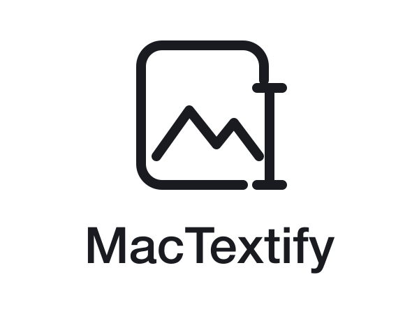
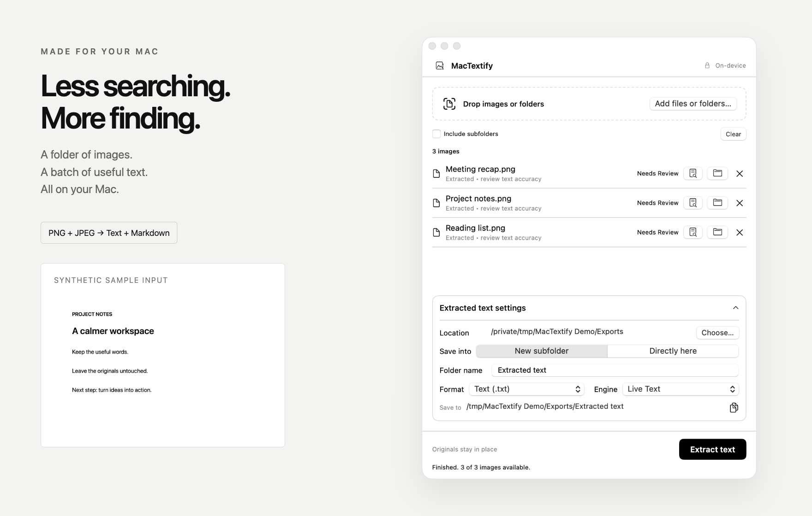
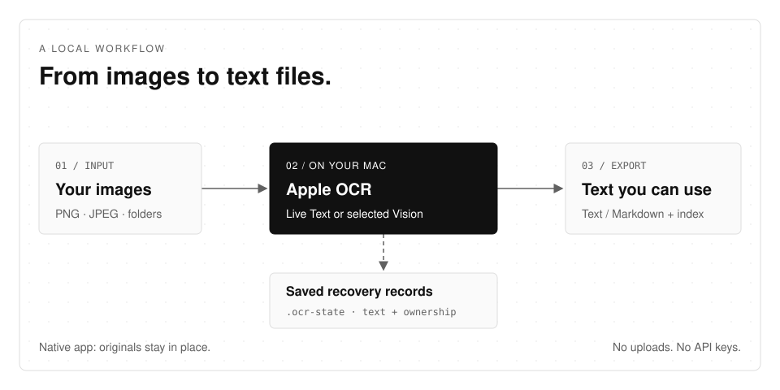
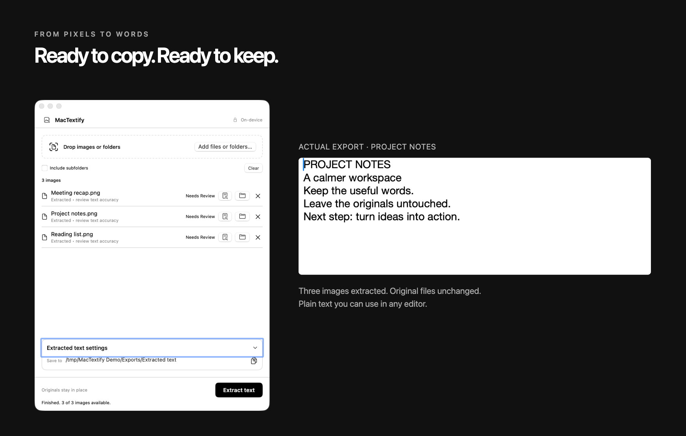

<p align="center">
  <picture>
    <source media="(prefers-color-scheme: dark)" srcset="assets/LogoDark.svg">
    
  </picture>
</p>

<h1 align="center">Text in images. Now text files.</h1>

<p align="center">
  Turn images into text you can search, copy, and keep.<br>
  A native Mac app. Apple OCR. Everything stays on your device.
</p>

<p align="center">
  <a href="https://sometheasiekswx.github.io/mactextify/">Website</a> ·
  <a href="#quick-start">Get started</a> ·
  <a href="#how-it-works">How it works</a> ·
  <a href="docs/cli.md">Command-line guide</a> ·
  <a href="docs/architecture.md">Architecture</a>
</p>

<p align="center">
  
</p>

<p align="center">
  <a href="assets/readme/app-workspace.png"></a>
</p>

<p align="center"><sub>Real app captures with synthetic sample documents. Original images stay in place.</sub></p>

## Keep the words. Keep your workflow.

A photo of a page. A scanned letter. A screenshot worth keeping. MacTextify extracts the words from PNG and JPEG images into individual text or Markdown files, with an index to find your way back. Search, copy, and edit the text without retyping it.

- **Made for your Mac.** A compact SwiftUI interface, drag-and-drop, and a native file-and-folder picker with ⌘O.
- **Private by design.** OCR runs locally with Apple Live Text or an explicitly selected Vision engine. No account, API key, subscription, or application network requests.
- **A batch, your way.** Mix files and folders, opt into subfolders, and choose exactly where exports go.
- **Files you own.** Plain text for a clean transcript. Markdown for recognized text, source links, and extraction metadata.
- **Careful with your work.** The app keeps originals in place, protects edited exports, and saves progress for recovery.

## Quick start

**MacTextify is currently a source build.** There is no official signed or notarized app download. Building requires **macOS 14+, Swift 5.9+, and full Xcode** with a compatible macOS SDK; Command Line Tools alone are not the supported setup. Runtime availability of Live Text depends on your hardware and OS. See [tested platforms](docs/validation.md) and [distribution status](docs/distribution.md).

```sh
git clone https://github.com/sometheasiekswx/mactextify.git
cd mactextify
./scripts/check-prerequisites.sh
./scripts/build-app.sh
open .build/MacTextify.app
```

The build creates a locally ad-hoc-signed development app. Install Apple’s developer tools separately if needed; the scripts do not download prerequisites. If Xcode is installed but not selected, complete its first-launch setup, then set its location in your Terminal session:

```sh
export DEVELOPER_DIR="/Applications/Xcode.app/Contents/Developer"
```

1. **Add your images.** Drop PNG/JPEG files or folders onto the window, or press ⌘O. Turn on **Include subfolders** when you need it.
2. **Choose where the text goes.** Expand **Extracted text settings**, choose a **Location**, then select **New subfolder** or **Directly here**. Pick text or Markdown and your OCR engine.
3. **Extract text.** Open or reveal each completed export from its queue row. Review the recognized text before relying on it.

**Directly here** means the exact directory shown in **Location**, including a folder containing your source images. **New subfolder** creates the named folder beneath it. Extraction starts when you click **Extract text**; **Stop after current image** preserves completed work.

## How it works

<p align="center">
  <picture>
    <source media="(prefers-color-scheme: dark)" srcset="assets/readme/workflow-dark.svg">
    
  </picture>
</p>

The native app and CLI share **OCRCore**. Live Text is the default engine; Vision is available when you select it. There is no silent fallback between engines. The CLI also exposes layout, language, scale, and archival options in the [command-line guide](docs/cli.md).

<p align="center">
  <a href="assets/readme/app-detail.png"></a>
</p>

## Simple output. Useful context.

A native-app batch saved into a new subfolder looks like this:

```text
Extracted text/
├── Project_notes--<sha256>.txt
├── Reading_list--<sha256>.txt
├── Meeting_recap--<sha256>.txt
├── index.md
└── .ocr-state/                  # Saved text, ownership and recovery records
```

Text exports contain recognized lines only. Markdown exports also include an original-image link, engine settings, source hash, and review status. `index.md` links the batch together without merging every document into one file. Keep annotations in separate files so generated exports stay verifiable.

### Recovery without guesswork

Edited or unowned exports and edited indexes are protected. A different OCR configuration for an existing image is a conflict; choose a new destination to compare settings. Keep the hidden `.ocr-state` records: they retain recognized text and establish ownership.

In the native app, missing exports from older, unselected images do not block a new batch or reappear automatically. Select the same image and extract with matching settings to restore a missing export from saved text. Retry a partial batch with the same destination and settings.

Use separate destinations for GUI and CLI runs: they have different receipt layouts. The [CLI guide](docs/cli.md#safety-and-recovery) documents its recovery and optional archival behavior.

### Know what OCR can miss

Review names, numbers, identifiers, and line order. OCR can misread characters; it does not reconstruct diagrams, color, highlighting, or semantic structure. Live Text does not expose confidence scores or line geometry, so those values are recorded as unavailable and exports are flagged for review. Vision confidence and agreement between passes also do not prove correctness.

Use local folders. Cloud/network coordination and hostile concurrent file changes are outside the support contract. Keep backups: recovery records help with ordinary interruptions, not every possible failure.

## Prefer the terminal?

Install the CLI locally, then extract a folder:

```sh
./scripts/install.sh
export PATH="$HOME/.local/bin:$PATH"
mactextify process --folder "$HOME/Documents/Images"
```

The CLI scans top-level PNG/JPEG files and keeps originals by default. Use `--output-folder` for a separate destination, `--format text` for plain text, or `--dry-run` to preview without OCR or filesystem changes. The optional `--archive` mode moves successfully exported originals; it cannot be combined with custom output mode.

Installation uses `~/.local/bin` and `~/.local/share/mactextify`, without `sudo`. A Finder launcher is also included. See the [full CLI guide](docs/cli.md) for custom prefixes, OCR options, recovery, upgrades, uninstall, and compatibility with older Screenshot OCR installations.

## Built in the open

```sh
swift build
swift test
python3 scripts/test-package-source.py
```

Python is used for developer checks and source packaging, not OCR or installation. Tests generate synthetic images; private images do not belong in the repository.

| Explore | Read more |
| --- | --- |
| Design and implementation | [Architecture](docs/architecture.md) · [GUI specification](tasks/macos-gui/SPEC.md) |
| Verification and release | [Validation](docs/validation.md) · [GUI verification](tasks/macos-gui/validation.md) · [Distribution](docs/distribution.md) |
| Get involved | [Contributing](CONTRIBUTING.md) · [Security](SECURITY.md) · [Changelog](CHANGELOG.md) |
| Presentation assets | [Screenshot and diagram provenance](docs/readme-assets.md) |

<p align="center">
  <sub><a href="LICENSE">MIT licensed</a> · Built with SwiftUI, AppKit, VisionKit, and Vision.<br>Apple frameworks are provided by macOS and are not bundled here.</sub>
</p>
